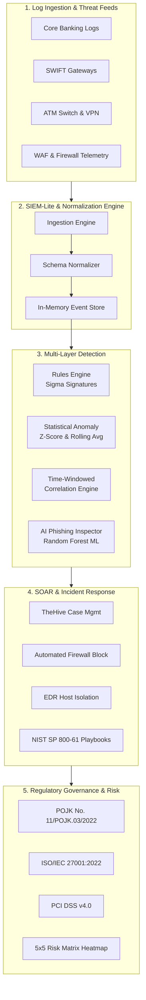

# Banking Cybersecurity Operations & GRC Platform

[](https://github.com/febriyansyah-id/cybersecurity/actions)
[](https://www.python.org/)
[](LICENSE)
[](tests/)
[](sec-compliance/)

> **Executive Security Portfolio**: Unified Banking Cyber Defense, Tier-1/2/3 SOC Automation, Machine Learning Phishing Detection, and Indonesian Regulatory GRC (POJK No. 11/POJK.03/2022).  
> **Author**: Febriyansyah — IT Cybersecurity & Infrastructure Leader (15+ yrs, Banking) | MTI Candidate

---

## 🖥️ Interactive Web Command Center

A fully interactive, zero-dependency **SOC Command Center Dashboard** is available right in the repository:

👉 **Open [`index.html`](index.html) in your browser** to launch the live interactive simulation:
- 🛡️ **Live Telemetry & Ingestion**: Real-time event graphs and searchable normalized SIEM stream
- 🚨 **Incident Response & SOAR Engine**: Interactive NIST SP 800-61 phase step executor with 1-click containment buttons (Firewall IP block, EDR host isolation, TheHive sync)
- 🎯 **AI Phishing URL Inspector**: Structural lexical heuristic analyzer with real-time risk index gauge
- 📋 **Banking GRC & 5x5 Heatmap Matrix**: Dynamic Likelihood × Impact calculator with adjustable control effectiveness slider
- ⚙️ **Sigma Threat Intelligence**: Searchable MITRE ATT&CK mapped detection rules and observable database

Or launch the full **Streamlit Production Dashboard**:
```bash
cd ai-soc-for-banking
pip install -r requirements.txt
streamlit run src/dashboard/app.py
```

---

## 📁 Curated 4-Pillar Architecture

```
CYBERSECURITY/
├── 🛡️ ai-soc-for-banking/     # Core SIEM-Lite, Correlation, Anomaly Detection & Streamlit Command Center
├── 🚨 soc-automation/         # NIST SP 800-61 IR Playbooks, Sigma Rules (MITRE ATT&CK), SOAR Connectors
├── 📋 sec-compliance/         # Banking GRC Toolkit: 5x5 Risk Matrix, ISO 27001, POJK 11/2022, Policy Generator
├── 🎯 phishing_detector/      # Content-Agnostic ML Classifier (Random Forest + 10 Lexical Feature Vectors)
├── 🌐 index.html              # Standalone Interactive Command Center UI (Tailwind CSS + Chart.js)
├── .gitignore                 # Optimized repository exclusion rules
└── README.md                  # Master documentation & architecture guide
```

---

## 🏛️ System Architecture



---

## 🚀 Quick Start Guide

### 1. Unified Dashboard (Streamlit)
```bash
cd ai-soc-for-banking
pip install -r requirements.txt
streamlit run src/dashboard/app.py
```

### 2. Run Comprehensive Test Suite
```bash
# Total 163 tests passed (0 failures)
cd ai-soc-for-banking && python -m pytest tests/ -q
cd ../soc-automation && python -m pytest tests/ -q
cd ../sec-compliance && python -m pytest tests/ -q
cd ../phishing_detector && python -m pytest tests/ -q
```

### 3. Phishing ML Inference CLI
```bash
# Single URL detection
python -m phishing_detector.src.classify --url "http://bank-secure-login.xyz/verify"

# Batch scan from file
python -m phishing_detector.src.classify --file sample_urls.txt
```

---

## 📜 Compliance Standards & Technical Frameworks

- **POJK No. 11/POJK.03/2022**: Information Technology Risk Management for Commercial Banks (Bank Indonesia / OJK)
- **NIST SP 800-61 Rev 2**: Computer Security Incident Handling Guide
- **NIST Cybersecurity Framework 2.0**: Govern, Identify, Protect, Detect, Respond, Recover
- **ISO/IEC 27001:2022**: Annex A Information Security Controls
- **PCI DSS v4.0**: Payment Card Industry Security Standards
- **MITRE ATT&CK**: Enterprise Tactics & Techniques Mapping
